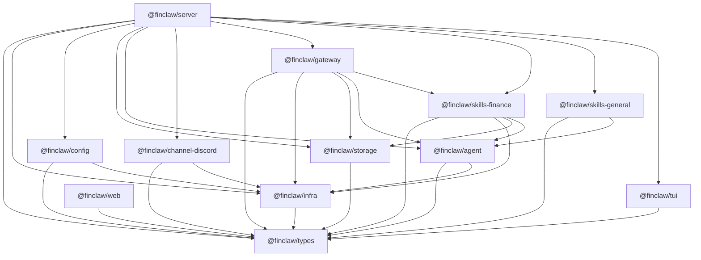
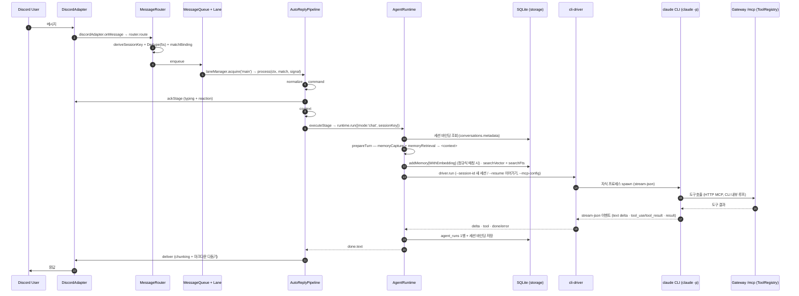

# FinClaw

> 본인 1인이 읽고 감사할 수 있는 금융 특화 AI 비서.

FinClaw 는 사용자 본인의 투자 판단·시장 조사·포트폴리오 관리를 보조하기 위한 개인용 AI 비서다. Anthropic Claude 를 코어로, Discord·Web UI·TUI 와 macOS 캐릭터 앱(핀)에서 동시에 호출할 수 있고, 시세·뉴스·알림·거래 이력·기억(RAG)·cron 자동화를 SQLite 단일 파일에 영속화한다. 프로덕트 출시·다인 사용·자동 매매를 목표로 하지 않으며, "전체 코드를 한 사람이 읽고 수정할 수 있는 크기" 와 "감사 가능성·환각 방지" 가 설계 우선순위다.

## 왜 FinClaw 인가

- **금융 도메인에 한정한 축약 코드베이스** — 12 워크스페이스 패키지, OpenClaw 아키텍처의 금융 특화 축소판. 한 사람이 전부 읽고 수정 가능한 크기를 의도.
- **감사 가능성 우선** — 모든 거래 입력·기억·RAG 주입 ID 가 SQLite (`transactions`, `memories`, `agent_runs`) 에 영속화되고, 모든 실행(Discord·Web/TUI·cron·`agent.run`)이 run 당 `agent_runs` 1행을 남기며, 회상 시 어떤 기억이 주입됐는지 로그로 남는다.
- **명시적 선언 기반 기억** — 사용자가 `!finclaw remember`, `기억해`, `메모`, `선호`, `내 (투자) 원칙은 …` 같은 정규식 패턴을 사용할 때만 저장. LLM 자동 추출은 환각 위험으로 의도적 비대상.
- **읽기 전용 + 수동 입력 거래 이력** — `finance.transaction.add` 는 사용자가 "이미 한 매매" 를 기록하는 경로지 "FinClaw 가 자동 매매" 가 아니다. holdings 는 transactions 로부터 파생.
- **외부 키 없이 작동하는 mock-only 테스트 스탠스** — 3-tier vitest (unit / storage / live) 분리. 라이브 API 호출은 `test:live` 로만 격리.

비대상: 다중 사용자·RBAC·SSO 가 필요한 팀·조직, 자동 매매 목적 사용자, OpenClaw 같은 범용 멀티채널 AI 플랫폼을 찾는 사용자.

## 빠른 시작 (5 분)

### 요구사항

| 항목    | 버전                                               |
| ------- | -------------------------------------------------- |
| Node.js | `>= 22.0.0` (`node:sqlite` 내장 모듈 사용)         |
| pnpm    | `10.4.1` (root `package.json` 의 `packageManager`) |
| Docker  | (선택, `pnpm dev:all` 사용 시)                     |

```bash
corepack enable
corepack prepare pnpm@10.4.1 --activate
```

### 설치

```bash
pnpm setup            # .env 복사 + pnpm install + ~/.finclaw/ 생성
# (선택) Discord 를 쓰려면 .env 에 DISCORD_BOT_TOKEN 입력 — 없으면 Discord 만 비활성
# 추론은 기본 Claude 구독(CLI, `claude login`) — ANTHROPIC_API_KEY 를 넣으면 API 과금 (아래 "Claude 구독(CLI)-only" 참고)
pnpm build
```

### 실행

```bash
# 로컬 단독 server (Discord + Gateway)
pnpm dev

# Docker 로 server + web 동시 기동
pnpm dev:all
```

부팅이 완료되면 로그에 `Gateway listening on 127.0.0.1:3000` 이 찍히고, Web/TUI/CLI 용 로컬 토큰이 `~/.finclaw/gateway.token` 에 기록된다(아래 "Web UI 접속"). Discord 봇이 온라인 상태가 되면 멘션이나 `!finclaw <메시지>` 로 대화할 수 있다.

> ⚠️ **함정**: `main()` 은 **현재 작업 디렉터리**의 `.env` 만 읽는다 (`process.loadEnvFile`, 이미 export 된 값은 덮어쓰지 않음). 레포 루트에서 `pnpm dev` 하면 루트 `.env` 가 로드되고, 다른 디렉터리에서 실행하면 셸 `export` 가 필요하다. Docker compose 는 `env_file: .env` 로 자동 주입한다.

### Claude 구독(CLI)-only (기본 모드)

FinClaw 는 **Anthropic API 키 없이 Claude 구독(`claude` CLI 로그인)만으로** 구동한다 (`provider: 'claude-cli'`, 유일한 백엔드). 턴마다 `claude -p --output-format stream-json` 자식 프로세스를 하나 띄우고(cwd `~/.finclaw/agent`), 그 이벤트 스트림을 `AgentRuntime` 이 받아 delta·도구·종료 이벤트로 흘린다. FinClaw 의 도구는 **in-process HTTP MCP**(`/mcp`)로 노출되어 CLI 가 자기 루프 안에서 직접 호출한다.

- **선행 조건:** `claude` CLI 설치 + `claude login`(구독 인증). `ANTHROPIC_API_KEY` 는 선택 — 설정하면 CLI 가 구독 대신 그 키를 쓰고 **API 크레딧으로 과금**된다(부팅 로그 `agent.auth` 로 확인).
- **읽기 전용:** `/mcp` 는 등록된 도구를 전부 노출하며, 등록 도구는 모두 **조회 전용**이다 — `get_current_datetime`, `route_task`, `list_alerts`, `get_alert_history`, 그리고 플러그인 MCP 도구(`mcp:*`). 알림 생성·삭제, 스케줄, 브로커리지 동기화, 거래 기록 같은 변경은 LLM 도구가 아니라 Web/TUI/CLI 의 RPC 로만 한다 — **주식 매수 권한은 사람에게만.**
- **격리:** CLI 내장 도구(Bash/Edit/Read 등)는 `--tools ""` 로 막고, `--setting-sources ""` 로 사용자 설정·CLAUDE.md·훅을, `--strict-mcp-config` 로 사용자 전역 MCP 설정을 배제한다. 시스템 프롬프트는 `--system-prompt` 로 통째로 교체한다.
- **대화별 세션:** 대화(sessionKey)마다 CLI 세션 하나를 `--session-id` 로 열고 다음 턴은 `--resume` 으로 잇는다(바인딩은 `conversations.metadata`). 6 시간 쉬면 새 세션으로 회전하고 직전 대화 몇 턴(recap)을 프롬프트 앞에 붙인다. cron·`agent.run` 은 세션을 남기지 않는 1회 실행(oneShot)이다.

## 기능

### 1. 대화 (auto-reply 파이프라인)

Discord 멘션 또는 `!finclaw <메시지>` 로 자연어 대화. 메시지 한 건이 들어오면 다음 6 단계 파이프라인을 거친다 (`packages/server/src/auto-reply/pipeline.ts`). 기억 저장·회상은 Execute 가 부르는 `AgentRuntime` 의 `prepareTurn` 안에서 돈다 — Web/TUI 채팅도 같은 경로다.

```
Normalize → Command → ACK → Context → Execute(AgentRuntime: MemoryCapture → MemoryRetrieval → claude -p) → Deliver
```

- **Command**: `!finclaw help|reset|status` 인-채팅 명령어. 시세·포트폴리오·알림은 자연어 대화로 요청한다.
- **MemoryCapture**: 정규식 5종(`!finclaw remember …`, `기억해: …`, `메모: …`, `선호: …`, `내 (투자) 원칙은 …`) 매칭 시 `memories` 테이블에 저장. SHA-256 dedup, 임베딩 실패 시 FTS-only fallback.
- **MemoryRetrieval**: 매 발화마다 hybrid (vector + FTS5) RAG 검색. 임계값 0.65, 신선도 반감기 90 일, 상한 3 개. 발화에서 추출된 티커별 거래 이력 3 건도 함께 user 메시지 앞 `<context>` 블록의 "사용자 배경지식 (자동 주입)" 섹션에 주입(시스템 프롬프트는 정적).

### 2. 금융 스킬 (LLM 도구)

대화 도중 `claude` CLI 가 `/mcp` 로 호출하는 도구 (전부 조회 전용). 키 미설정 시 해당 도구는 **등록 자체를 건너뛴다** (graceful degradation).

| 도구                                 | 내용                                                                                                                                                                                                     | 등록 조건                                                                                                                                                                                                |
| ------------------------------------ | -------------------------------------------------------------------------------------------------------------------------------------------------------------------------------------------------------- | -------------------------------------------------------------------------------------------------------------------------------------------------------------------------------------------------------- |
| `route_task(intent, query, symbol?)` | 도메인 작업 위임. intent: `price_lookup` · `chart_data` · `news_summary` · `portfolio_calc` (함수 직접 호출) / `market_analysis` (sub-agent `claude -p` 재호출, `prompts/sub-agents/market_analysis.md`) | 시세 키 1개 이상 (`FINNHUB_KEY` / `TWELVE_DATA_KEY` / `ALPHA_VANTAGE_KEY` / `COINGECKO_API_KEY`). 뉴스 의존 intent 는 뉴스 키(`NEWSDATA_API_KEY` / `FINNHUB_KEY` / `ALPHA_VANTAGE_KEY`) 없으면 에러 결과 |
| `list_alerts`, `get_alert_history`   | 알림 조회 (내부 SQLite). 알림 생성은 RPC `finance.alert.create` 로만                                                                                                                                     | 시세 + 뉴스 키                                                                                                                                                                                           |
| `get_current_datetime`               | 현재 시각                                                                                                                                                                                                | 항상                                                                                                                                                                                                     |
| `mcp:*`                              | 플러그인 MCP 도구 (`FINCLAW_PLUGINS_DIR`, 기본 `~/.finclaw/plugins`). 정책 `require-approval`                                                                                                            | 플러그인 있을 때                                                                                                                                                                                         |

시세 프로바이더 우선순위는 Finnhub → Twelve Data → Alpha Vantage → CoinGecko → Frankfurter (외환, 키 불필요 — 단 위 시세 키가 하나는 있어야 `route_task` 가 등록된다).

### 3. 자동화 (cron 스케줄러, Phase 28)

Web Settings 또는 `schedule.create` RPC 로 cron 표현식과 prompt 를 등록하면, `SchedulerService` 가 매 분 폴러로 매칭되는 schedule 을 찾아 `AgentRuntime` oneShot(비영속, 직전 대화 없음, `<context>` 는 현재 시각만)으로 실행하고 결과를 Discord DM 또는 Web 알림으로 송출한다.

- Cron 파서: 5필드 (분 시 일 월 요일), `*`, `*/N`, `M-N`, `M,N,O` 지원. `L`/`W`/`?` 비지원.
- 연속 실패 자동 비활성화: `AUTOMATION_MAX_CONSECUTIVE_FAILURES` (기본 3) 회 연속 실패 시 schedule 을 자동 비활성.
- 직렬화: `ConcurrencyLane(maxConcurrent: 1, queueSize: 50, waitTimeoutMs: 5분)`.
- Stagger: 정각 반복 cron(`0 * …`)은 schedule id 해시로 정해지는 0~5분 오프셋만큼 늦게 발화한다(결정적 — 같은 schedule 은 항상 같은 분).

### 4. 운영 인터페이스

| 인터페이스                    | 진입점                                 | 주요 기능                                                                                                                 |
| ----------------------------- | -------------------------------------- | ------------------------------------------------------------------------------------------------------------------------- |
| **Web UI** (Lit + Vite)       | 브라우저, gateway WS                   | 5 탭 — Chat / Market / Portfolio (보유종목 + 거래 이력 + 거래 추가 모달) / Alerts / Settings (기억 / 자동화 / agent_runs) |
| **TUI** (Ink + React)         | `finclaw tui`                          | 4 탭 — chat / market / portfolio / alerts                                                                                 |
| **CLI** (commander)           | `finclaw <cmd>`                        | `start` / `health` / `status` / `agent {list,status}` / `market quote` / `news` / `alert {add,list}` / `tui`              |
| **macOS 캐릭터 앱** (SwiftUI) | `apps/mac` → `FinClaw.app`, gateway WS | 데스크톱 캐릭터 "핀" — 대화 · 가격 알림/브리핑 먼저 알림 · 알림 만들기/삭제 ([`apps/mac/README.md`](apps/mac/README.md))  |

#### macOS 캐릭터 앱 (핀)

macOS 14+ 와 Swift 6 툴체인이 있으면 서버(`pnpm dev`)를 띄운 뒤 `bash apps/mac/scripts/bundle.sh && open apps/mac/dist/FinClaw.app` 으로 실행한다. 토큰은 `~/.finclaw/gateway.token` 을 자동으로 읽는다. 시스템 알림 권한은 첫 알림이 올 때 묻는다. 알림은 대화 패널의 "알림" 탭에서 직접 만든다(시세·뉴스 API 키 필요). Discord 는 선택 채널이라 없어도 맥 앱의 알림·브리핑은 동작한다.

개발 중 에이전트 환경에서는 스냅샷(`--snapshot`)과 헤드리스 스모크(`--smoke`)만 검증했다. 알림 권한·배너, 입력창 타이핑·포커스, 드래그, 투명도·Spaces·전체 화면, 메뉴바 5항목, 실제 알림 생성/삭제(시세 키 필요)는 사람이 확인해야 한다 — 체크리스트는 [`apps/mac/README.md`](apps/mac/README.md#사람이-직접-확인해야-하는-것).

### 5. Gateway JSON-RPC (38 개 메서드)

HTTP `POST /rpc` + WebSocket `ws://…/ws` 에서 동일 JSON-RPC 2.0 스키마로 호출 가능. Zod v4 스키마 검증, 3 단계 권한 (`none / api_key / token`). 같은 서버의 `/mcp` 는 `claude` CLI 용 MCP 엔드포인트다.

| 그룹           | 메서드                                                                                                                 |
| -------------- | ---------------------------------------------------------------------------------------------------------------------- |
| `system.*`     | `health`, `info`, `ping`                                                                                               |
| `chat.*`       | `start`, `send`, `abort`, `reset`, `history`                                                                           |
| `session.*`    | `get`                                                                                                                  |
| `agent.*`      | `list`, `status`, `run`                                                                                                |
| `agent.runs.*` | `list`, `get` (감사 이력)                                                                                              |
| `memory.*`     | `list`, `delete`, `search` (hybrid/FTS)                                                                                |
| `finance.*`    | `quote`, `news`, `alert.create`, `alert.list`, `alert.delete`, `portfolio.get`, `transaction.{add,list,update,delete}` |
| `schedule.*`   | `create`, `list`, `update`, `delete`, `runNow`, `history`, `enable`, `disable`, `testCron`                             |
| `brokerage.*`  | `sync.run`, `health.get` (KIS read-only 잔고 동기화)                                                                   |

WebSocket notification: `chat.stream.{delta,tool,end,error}` (모두 `runId` 포함), `portfolio.changed`, `schedule.completed`, `alert.triggered`.

- `chat.send` 는 실행을 기다리지 않고 즉시 `{runId}` 를 돌려준다. `runId`(UUID)를 넘기면 그 값을 쓴다(진행 중 같은 값이면 `duplicate runId`). 진행·결과는 `chat.stream.*` 로 온다 — `delta` N 회 뒤 `end`(확정 텍스트) 또는 `error` 가 정확히 1 회.
- `chat.stream.tool` 은 도구 시작/끝(`phase: start|end`, 도구 이름·`toolCallId`)만 알린다 — 입력·결과 내용은 싣지 않는다.
- `chat.history {sessionId, limit?}` 는 그 대화의 최근 user/assistant 메시지(`{role, text}`, 기본 20·최대 40)를 돌려준다.
- `finance.alert.create` 의 기본 전달 채널은 `['log', 'websocket']`(발동 시 `alert.triggered` 로 WS 클라이언트에 전달)이고, `DISCORD_BOT_TOKEN` 과 `DISCORD_ALERT_USER_ID` 가 둘 다 있을 때만 `'discord'` 가 붙는다. `finance.alert.delete {alertId}` 는 발동 기록까지 함께 지운다.
- `chat.abort {sessionId, runId?}` 는 진행 중 실행을 끊는다(종료 신호는 `chat.stream.error{reason:'aborted'}`). `chat.reset {sessionId}` 는 그 대화의 CLI 세션 바인딩을 지워 다음 턴을 새 세션으로 시작한다.

### 6. 기억 / RAG (Phase 26)

- **저장:** `memories` 테이블 (4 type: `fact` / `preference` / `summary` / `financial`), `memory_chunks_vec` (1024-d), `memory_chunks_fts` (trigram).
- **회상:** hybrid vector + FTS, 임계값 0.65, 신선도 반감기 90 일, 상한 3 개.
- **agent.run 결과 → memory:** output 길이 > 100자 + error 없음 시 `type='financial'` 로 자동 저장 (`agent_runs.memory_id` 링크). 이 훅의 존폐는 phase47 에서 결정.
- **임베딩 프로바이더:** `VOYAGE_API_KEY` 또는 `OPENAI_API_KEY` 가 있으면 `createEmbeddingProvider('auto')` 시도. 실패/미설정 시 모든 경로 FTS-only fallback (best-effort, 파이프라인 차단 없음).
- **OpenAI 임베딩:** vec0 DDL 이 1024D 라 OpenAI `text-embedding-3-small` 은 `dimensions: 1024` truncation 으로 맞춘다. Voyage `voyage-finance-2` 권장.

## 아키텍처

### 패키지 의존 그래프



순환 의존 없음. `types` 가 유일한 leaf, `server` 가 `web` 을 뺀 모든 패키지를 흡수해 부팅. `tui` / `web` 은 런타임에 게이트웨이 WebSocket 으로 통신하지만 코드상으로는 `types` 만 import.

### 런타임 토폴로지

| 프로세스                          | 진입점                                                 | 점유 포트                                                       | 역할                                                                             |
| --------------------------------- | ------------------------------------------------------ | --------------------------------------------------------------- | -------------------------------------------------------------------------------- |
| `@finclaw/server` (Node 22+, ESM) | `packages/server/src/main.ts` (`main()`)               | `GATEWAY_PORT` (기본 `3000`, host `127.0.0.1` — `GATEWAY_HOST`) | Discord 수신 · 파이프라인 · LLM · 스토리지 · gateway · cron 을 1 프로세스에 흡수 |
| `claude` CLI (자식 프로세스)      | 턴마다 `claude -p --output-format stream-json` spawn   | (없음)                                                          | 추론. 도구는 server 의 `/mcp` 로 HTTP 호출                                       |
| `@finclaw/web`                    | `packages/web/src/main.ts` (Vite 빌드 또는 `vite dev`) | Vite 기본 `5173`                                                | 브라우저 클라이언트, gateway WS + JSON-RPC                                       |
| `@finclaw/tui`                    | `packages/tui/src/index.ts`                            | (stdin/stdout)                                                  | gateway WebSocket 으로 chat 세션 유지하는 ink/React TUI                          |

### 데이터 흐름: Discord 메시지 → 응답



부팅 부수 흐름:

- **자동화 (cron):** `SchedulerService.start()` 가 매 분 0초 `findDueSchedules` → `scheduleLane` → `runtime.run({mode:'oneShot'})` → `onRunComplete` → Discord DM 또는 WebSocket broadcast.
- **gateway RPC:** Web/TUI 의 `agent.runs.list`, `finance.transaction.add`, `memory.search` 등 호출은 `dispatchRpc` → 등록 핸들러 → `storage.db` 직접 호출. `chat.send`·`agent.run` 은 같은 `AgentRuntime` 으로 실행한다.

## 패키지 구조

| 패키지                     | 역할                                                                                        | workspace 의존                                                                                                          |
| -------------------------- | ------------------------------------------------------------------------------------------- | ----------------------------------------------------------------------------------------------------------------------- |
| `@finclaw/types`           | 모든 패키지 공유 contract (브랜드 타입 + enum)                                              | (none)                                                                                                                  |
| `@finclaw/infra`           | logger, eventbus, fetch, ports, ConcurrencyLane, ALS context, SSRF, cron, circuit-breaker   | `types`                                                                                                                 |
| `@finclaw/config`          | JSON5 설정 로딩, Zod 스키마, env 치환, strict 검증                                          | `types`, `infra`                                                                                                        |
| `@finclaw/storage`         | SQLite (`node:sqlite`) + sqlite-vec, 스키마 v12, transactions/agent_runs/schedules/memories | `types`                                                                                                                 |
| `@finclaw/agent`           | stream-json 드라이버(`runtime/cli-driver.ts`), tool registry (정책·가드·감사)               | `types`, `infra`                                                                                                        |
| `@finclaw/channel-discord` | Discord 채널 어댑터 (discord.js v14)                                                        | `types`, `infra`                                                                                                        |
| `@finclaw/skills-finance`  | market / news / alerts / brokerage(KIS) 서비스 + 알림 조회 도구, 시세 캐시                  | `types`, `infra`, `storage`, `agent`                                                                                    |
| `@finclaw/skills-general`  | `get_current_datetime`, `route_task` 도구                                                   | `types`, `agent`                                                                                                        |
| `@finclaw/gateway`         | HTTP/JSON-RPC + WebSocket 서버, `/mcp` (in-process HTTP MCP), 인증, access log              | `types`, `infra`, `storage`, `agent`, `skills-finance`                                                                  |
| `@finclaw/server`          | 진입점, auto-reply 파이프라인, route_task 디스패처, 자동화, 플러그인, CLI                   | `types`, `infra`, `config`, `storage`, `agent`, `channel-discord`, `gateway`, `skills-finance`, `skills-general`, `tui` |
| `@finclaw/tui`             | Ink + React 기반 터미널 UI (gateway WS 클라이언트)                                          | `types`                                                                                                                 |
| `@finclaw/web`             | Lit + Vite 기반 웹 UI (gateway WS 클라이언트 + 마크다운)                                    | `types`                                                                                                                 |

`apps/mac/` — SwiftPM 패키지(외부 의존성 0, pnpm 워크스페이스 밖). `FinClawMacCore`(프로토콜·리듀서, `swift test`) + `FinClawMac`(실행 파일).

신규 컨트리뷰터를 위한 코드 읽기 순서:

1. `packages/server/src/main.ts` — `main()` 한 곳에서 모든 wiring (env → 로거 → config → storage → discord → agent/tools → 파이프라인 → router → gateway → scheduler).
2. `packages/server/src/process/message-router.ts` — Discord InboundMessage → dedupe → bind matching → queue → lane → pipeline.
3. `packages/server/src/auto-reply/pipeline.ts` — 6 단계 스테이지 호출 + abort 신호 + (선택) OTel span.
4. `packages/server/src/auto-reply/stages/` — 각 스테이지 구현.
5. `packages/agent/src/runtime/cli-driver.ts` + `packages/server/src/agent-runtime/{runtime,prepare-turn}.ts` — `claude -p` stream-json 1턴 실행(도구 루프는 CLI 내부), 세션 바인딩·컨텍스트 주입·`agent_runs` 기록.
6. `packages/storage/src/database.ts` + `index.ts` — 스키마 (v12) + `createStorage` 팩토리.
7. `packages/gateway/src/server.ts` + `rpc/index.ts` + `rpc/methods/` + `mcp/` — JSON-RPC·MCP 표면.
8. `packages/server/src/automation/scheduler.ts` — cron 폴러.

## 환경변수

`.env.example` 을 복사 (`cp .env.example .env`). `grep -rn "process.env" packages/` 결과 기준 전수.

### 선택 — Discord (필수 env 없음)

| 변수                    | 설명                                                                                                                                                                          |
| ----------------------- | ----------------------------------------------------------------------------------------------------------------------------------------------------------------------------- |
| `DISCORD_BOT_TOKEN`     | Discord 봇 로그인 토큰. 없으면 Discord 만 비활성(`discord.disabled`)                                                                                                          |
| `DISCORD_ALERT_USER_ID` | 가격·뉴스 알림 DM 수신자(Discord 사용자 id). `DISCORD_BOT_TOKEN` 과 함께 있을 때만 새 알림에 discord 채널이 붙는다. 설정하면 예전 `['log','discord']` 알림도 이 id 로 DM 된다 |

추론은 기본으로 `claude login` 구독 인증을 쓴다. `ANTHROPIC_API_KEY` 를 설정하면 구독 대신 그 키(API 과금)를 쓴다.

### 선택 — 금융 데이터

키는 CSV(`KEY=a,b,c`) 또는 인덱스(`KEY_1`, `KEY_2` … `KEY_10`) 형식으로 여러 개 넣어 rotation 할 수 있다.

| 변수                | 동작                |
| ------------------- | ------------------- |
| `FINNHUB_KEY`       | 시세 (1순위) + 뉴스 |
| `TWELVE_DATA_KEY`   | 시세 (2순위)        |
| `ALPHA_VANTAGE_KEY` | 시세 (3순위) + 뉴스 |
| `COINGECKO_API_KEY` | 암호화폐 시세       |
| `NEWSDATA_API_KEY`  | 영문 뉴스           |

시세 키가 하나도 없으면 `route_task`·알림 도구 등록을 건너뛴다. 뉴스 키(`FINNHUB_KEY` / `ALPHA_VANTAGE_KEY` / `NEWSDATA_API_KEY`)가 없으면 뉴스 의존 intent 와 알림 도구가 비활성.

### 선택 — 증권사 연동 (한국투자증권 KIS, read-only)

| 변수                       | 설명                                     |
| -------------------------- | ---------------------------------------- |
| `KIS_ENV`                  | `prod`(실전) \| `vts`(모의). 기본 `prod` |
| `KIS_APP_KEY`              | KIS Open API app key                     |
| `KIS_APP_SECRET`           | KIS Open API app secret                  |
| `KIS_ACCOUNT_NO`           | 계좌번호 CANO (8자리)                    |
| `KIS_ACCOUNT_PRODUCT_CODE` | 계좌상품코드 ACNT_PRDT_CD (기본 `01`)    |

`KIS_APP_KEY`/`KIS_APP_SECRET`/`KIS_ACCOUNT_NO` 중 하나라도 미설정 시 brokerage 동기화 서비스를 건너뛴다(`KIS not configured` 로그). `BROKERAGE_PROVIDER` 는 기본 `kis` (`toss` 는 미구현 — 경고 후 skip). KIS 연동은 **read-only**(잔고 조회만, 매매 없음)이며, 동기화는 LLM 도구가 아니라 RPC `brokerage.sync.run` (Web Settings) 으로만 실행된다. 동기화된 보유 종목은 `portfolio_holdings.source='kis'` 로 저장되어 거래 파생(`source='tx'`) holdings 와 분리된다.

### 선택 — Gateway / Web UI 인증

| 변수                                  | 기본값                      | 비고                                                                   |
| ------------------------------------- | --------------------------- | ---------------------------------------------------------------------- |
| `FINCLAW_API_KEY`                     | (없음 = 인증 비활성)        | 설정 시 `X-API-Key` 헤더 검증 (단일 키)                                |
| `GATEWAY_JWT_SECRET`                  | `~/.finclaw/gateway.secret` | 없거나 빈 값이면 최초 부팅에 32바이트 secret 을 자동 생성(0600)·재사용 |
| `GATEWAY_PORT`                        | `3000`                      | `Number()` 변환 후 strict 검증                                         |
| `GATEWAY_HOST`                        | `127.0.0.1`                 | 바인딩 호스트. Docker 는 `0.0.0.0`                                     |
| `AUTOMATION_MAX_CONSECUTIVE_FAILURES` | `3`                         | 연속 실패 N회 시 schedule 자동 비활성                                  |

> 부팅마다 이 secret 으로 서명한 30일짜리 로컬 토큰을 `~/.finclaw/gateway.token`(0600) 에 다시 쓴다. TUI·CLI 는 이 파일을 읽어 인증한다. 토큰·secret 은 로그에 찍히지 않는다.

### 선택 — 저장소 / 파일

| 변수                  | 기본값                                                                         |
| --------------------- | ------------------------------------------------------------------------------ |
| `FINCLAW_DB_PATH`     | 로컬: `~/.finclaw/db.sqlite` / Docker: `/data/db.sqlite`                       |
| `FINCLAW_CONFIG`      | (없음 — fallback chain: `~/.finclaw/config/finclaw.json5` → `./finclaw.json5`) |
| `FINCLAW_PLUGINS_DIR` | `~/.finclaw/plugins`                                                           |

### 선택 — 임베딩 (Phase 26 RAG)

| 변수             | 동작                                                                   |
| ---------------- | ---------------------------------------------------------------------- |
| `VOYAGE_API_KEY` | 둘 중 하나 있으면 hybrid 검색 활성. 없으면 모든 경로 FTS-only fallback |
| `OPENAI_API_KEY` | Voyage fallback. 1024D 로 truncation 해 vec0 에 맞춤 (Voyage 권장)     |

## 설정 파일 (`finclaw.json5`)

`config.example.json5` 을 복사 (파일 자체가 선택 — 없으면 기본값). 해석 우선순위: `FINCLAW_CONFIG` → `~/.finclaw/config/finclaw.json5` → `./finclaw.json5`. 모든 섹션이 `z.strictObject()` — 알 수 없는 키가 있으면 부팅이 차단된다. 값의 `${ENV}` 는 환경변수로 치환된다.

| 키           | 내용                                                                                      |
| ------------ | ----------------------------------------------------------------------------------------- |
| `provider`   | `'claude-cli'` 만 허용 (유일한 백엔드, 생략 가능)                                         |
| `cliBackend` | `command` (`claude` 실행 파일)                                                            |
| `rag`        | `rerank.{enabled,topKFirst}`                                                              |
| `accessLog`  | `retentionDays`                                                                           |
| `gateway`    | `auth.token` (`finclaw tui` 가 게이트웨이에 보낼 토큰, 없으면 `~/.finclaw/gateway.token`) |

게이트웨이 포트는 config 가 아니라 `GATEWAY_PORT` env, 바인딩 호스트는 `GATEWAY_HOST` env(기본 `127.0.0.1`)다.

## 명령어

| 명령어                       | 설명                                                 |
| ---------------------------- | ---------------------------------------------------- |
| `pnpm setup`                 | `.env` 복사 + `pnpm install` + `~/.finclaw/` 생성    |
| `pnpm dev`                   | 로컬 단독 server (`tsx packages/server/src/main.ts`) |
| `pnpm dev:all`               | Docker 위 server + web 동시 (`scripts/dev-all.sh`)   |
| `pnpm build`                 | TypeScript project references 빌드 (`tsc --build`)   |
| `pnpm clean`                 | dist + tsbuildinfo 제거                              |
| `pnpm typecheck`             | `tsgo --noEmit` (TypeScript-Go)                      |
| `pnpm lint`                  | `oxlint --config oxlintrc.json .`                    |
| `pnpm format` / `format:fix` | `oxfmt --check .` / `oxfmt --write .`                |
| `pnpm test`                  | unit (mock 만)                                       |
| `pnpm test:storage`          | DB 격리 (`maxWorkers=1`)                             |
| `pnpm test:live`             | 실제 `claude` CLI 호출 (수동)                        |
| `pnpm test:ci`               | unit + storage 병렬 (CI)                             |
| `pnpm test:coverage`         | v8 커버리지 (임계 70/70/70/55)                       |

추가 보조 스크립트: `scripts/build-docker.sh`, `scripts/build-skills.ts`, `scripts/verify-pack-includes-prompts.sh`, `scripts/calver.ts`, `scripts/write-build-info.ts`, `scripts/check-dep-versions.ts`.

## 운영

### 테스트 (3-tier)

| Tier        | Config                     | 격리                                   | 외부 의존                       |
| ----------- | -------------------------- | -------------------------------------- | ------------------------------- |
| **unit**    | `vitest.config.ts`         | local: `max(4, min(16, cpus))` / CI: 3 | mock 만, env isolated           |
| **storage** | `vitest.storage.config.ts` | `maxWorkers=1` (DB 충돌 방지)          | tmp SQLite DB                   |
| **live**    | `vitest.live.config.ts`    | `maxWorkers=1`, 60s timeout            | 실제 `claude` CLI (구독 로그인) |

`test/setup.ts` + `test-env.ts` 가 `beforeAll` 에 sensitive 키(`DISCORD_BOT_TOKEN`, `GATEWAY_JWT_SECRET`, 시세·뉴스·임베딩·KIS 키, `FINCLAW_*` 경로, `NODE_OPTIONS` 등) 를 삭제하고, `HOME` / `FINCLAW_DB_PATH` 를 tmpdir 로 강제 설정한다 — 테스트가 사용자 DB 를 건드리지 않는다.

CI (`.github/workflows/ci.yml`): `lint` → `format` → `typecheck` → `build` → `test:ci`. pnpm 버전은 `package.json#packageManager`, Node 버전은 `.node-version` 에서 자동 감지.

### Docker

```bash
pnpm dev:all   # docker compose up --build
```

`docker-compose.yml`:

| 서비스   | 이미지          | 포트 (host:container)                  | 마운트                              | 헬스체크              |
| -------- | --------------- | -------------------------------------- | ----------------------------------- | --------------------- |
| `server` | `finclaw:local` | `127.0.0.1:${GATEWAY_PORT:-3000}:3000` | `finclaw-data:/data` (named volume) | `GET /healthz` 매 30s |
| `web`    | `finclaw:local` | `${FINCLAW_WEB_PORT:-5173}:5173`       | -                                   | disabled              |

빌드 흐름 (`Dockerfile`): `node:22-bookworm-slim` 기반 multi-stage. builder 에서 `pnpm install --frozen-lockfile` → `pnpm build` + `pnpm --filter @finclaw/web build`. runner 는 non-root `USER node` 로 `node packages/server/dist/main.js` 실행. web 컨테이너는 compose 가 override 해 `pnpm exec vite preview --host 0.0.0.0 --port 5173`. 컨테이너 안 server 는 항상 `0.0.0.0:3000`(`GATEWAY_HOST=0.0.0.0`) 에서 listen 하고, `.env` 의 `GATEWAY_PORT` 는 호스트 쪽 포트만 바꾼다.

> ⚠️ 이미지에는 `claude` CLI 가 들어 있지 않다. 컨테이너에서 추론을 돌리려면 CLI 설치와 로그인 정보가 별도로 필요하다.

이미지만 빌드: `bash scripts/build-docker.sh [name] [tag]` (기본 `finclaw:dev`).

### Web UI 접속 / RPC 호출

브라우저 Web UI 접속에는 **JWT (HS256)** 가 필요하다. 서버가 부팅마다 `~/.finclaw/gateway.token` 에 써 두는 토큰을 `?token=` 쿼리 파라미터로 전달한다(토큰은 로그에 찍히지 않으니 파일에서 읽는다):

```bash
cat ~/.finclaw/gateway.token
# Docker: docker compose exec server cat /home/node/.finclaw/gateway.token
```

브라우저:

```
http://localhost:5173/?token=<gateway.token 내용>
```

curl 로 RPC:

```bash
curl -X POST http://localhost:3000/rpc \
  -H "Content-Type: application/json" \
  -H "Authorization: Bearer $(cat ~/.finclaw/gateway.token)" \
  -d '{"jsonrpc":"2.0","id":1,"method":"finance.portfolio.get","params":{}}'
```

### 트러블슈팅 (실측)

| 증상                                                                         | 원인                                                                 | 대응                                                                                                                          |
| ---------------------------------------------------------------------------- | -------------------------------------------------------------------- | ----------------------------------------------------------------------------------------------------------------------------- |
| WS 인증 실패                                                                 | 토큰이 현재 secret 으로 서명되지 않음 (`GATEWAY_JWT_SECRET` 변경 등) | `~/.finclaw/gateway.token` 을 다시 읽어 사용. 빈 `GATEWAY_JWT_SECRET=` 은 미설정으로 보고 `~/.finclaw/gateway.secret` 을 쓴다 |
| `pnpm dev:all` 즉시 종료 + `.env not found`                                  | `scripts/dev-all.sh` 의 사전 체크                                    | `pnpm setup` 또는 `cp .env.example .env`                                                                                      |
| `Read/Write/Edit ENOENT` (WSL `/mnt/c/...`)                                  | WSL2 ↔ Windows 크로스 파일시스템 캐시                                | 같은 파일을 다시 Read 하면 해소                                                                                               |
| lefthook hook 이 `node: command not found`                                   | git hook 은 minimal `sh` 에서 동작, nvm PATH 부재                    | `lefthook.yml` 의 `rc: ./.lefthookrc` 가 `.node-version` 읽어 PATH 주입 — `./` prefix 필수                                    |
| `pnpm format:fix` 후 `package.json` 키 reorder                               | oxfmt 가 키 순서 재정렬                                              | edit 후 한 번 더 `pnpm format:fix` 실행                                                                                       |
| `commit-msg` hook 이 한글 subject 거부                                       | dash + C.UTF-8 grep conventional 검증                                | subject 는 ASCII conventional commits 로                                                                                      |
| `[fatal] Port 3000 is in use by …`                                           | `assertPortAvailable` + `inspectPortOccupant`                        | 점유 프로세스 종료 또는 `GATEWAY_PORT` 변경                                                                                   |
| `Failed to create embedding provider — memory.search will use FTS-only` warn | Voyage/OpenAI 키 둘 다 없거나 생성 실패                              | 의도된 graceful fallback. 무시 가능. 키 채우면 hybrid 활성                                                                    |

## 보안

- **인증 모델:**
  - `FINCLAW_API_KEY` 설정 시 → API key 인증 활성 (`X-API-Key` 헤더, 단일 키).
  - JWT (HS256) — WebSocket `?token=`, HTTP `Authorization: Bearer …` 모두 지원.
  - secret 미설정 시 `~/.finclaw/gateway.secret`(0600) 을 최초 1회 랜덤 생성해 재사용하고, 부팅마다 30일짜리 로컬 토큰을 `~/.finclaw/gateway.token`(0600) 에 쓴다. 토큰·secret 은 로그에 남지 않는다.
- **네트워크 노출:** gateway 는 기본 `127.0.0.1` 에만 바인딩하고(`GATEWAY_HOST` 로 변경, Docker 는 `0.0.0.0`), CORS origin 은 `http://localhost:5173`·`http://127.0.0.1:5173` 두 개뿐이다.
- **Non-root 컨테이너:** `Dockerfile` 의 `USER node`, `/data` 디렉토리 owner = node:node.
- **테스트 격리:** `test-env.ts` 가 `DISCORD_BOT_TOKEN`·API 키 등 sensitive 키를 테스트 시작 시 삭제.
- **Strict config:** `z.strictObject()` 로 알 수 없는 키 거부.
- **LLM 도구는 조회 전용:** `/mcp` 로 노출되는 도구에 상태 변경·파일 읽기·웹 페치가 없다. CLI 내장 도구는 `--tools ""` 로 차단.
- **Conventional commits 강제:** `lefthook.yml` (변경 이력 감사 가능성).

## 기여 / 개발 워크플로우

- 브랜치 · 커밋 · PR 규칙은 [`CONTRIBUTING.md`](./CONTRIBUTING.md) 를 따른다 (`main` 직접 커밋 금지, `<type>/<slug>` 브랜치, ASCII Conventional Commits, merge commit 머지).
- 신규 패키지 추가 시: `pnpm-workspace.yaml` glob 에 자동 포함, `tsconfig.json` references 에 추가, `composite: true` 유지, workspace 의존은 `workspace:*` 프로토콜.
- 개발 절차(계획 검토 · 리뷰 · QA · 출하)는 CLAUDE.md 의 "개발 워크플로 (gstack)" 를 따른다.

## 기술 스택 요약

- **런타임:** Node.js 22+ (ESM, `node:sqlite`, `process.loadEnvFile`)
- **언어:** TypeScript (strict mode, project references), TypeScript-Go (`tsgo`) 로 typecheck
- **테스트:** Vitest 4 (3-tier)
- **린트 / 포매팅:** oxlint / oxfmt (Rust 기반)
- **DB:** SQLite (`node:sqlite` 내장) + sqlite-vec, FTS5
- **AI:** `claude` CLI (Claude 구독, `claude -p`) + `@modelcontextprotocol/sdk` (in-process HTTP MCP)
- **채널:** discord.js v14
- **Web UI:** Lit + Vite + marked + DOMPurify
- **TUI:** Ink + React
- **CLI:** commander
- **Hooks:** lefthook
