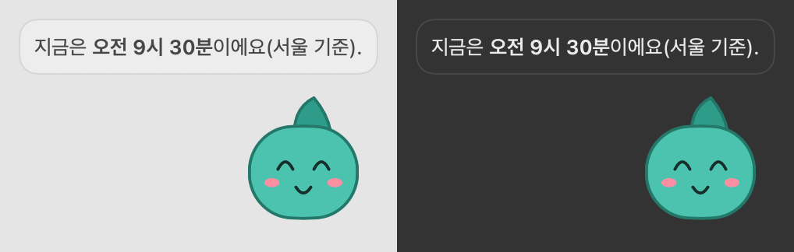
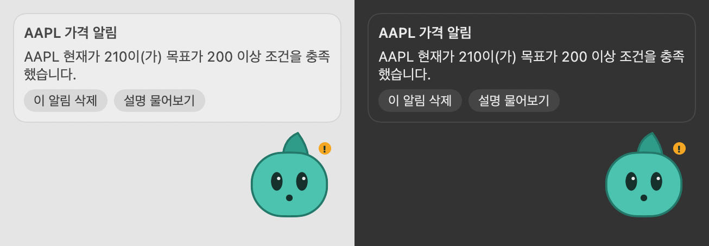
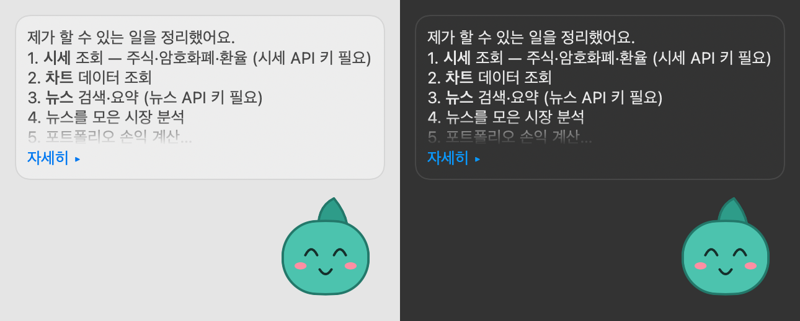

# FinClaw 맥 캐릭터 앱 — 핀

데스크톱 오른쪽 아래에 떠 있는 캐릭터 "핀"으로 FinClaw 와 대화하고, 가격·뉴스 알림과 예약 브리핑을 먼저 전해 받는 macOS 앱이다. 서버(`pnpm dev`)의 gateway WebSocket 에 붙는 클라이언트일 뿐이라 대화·기억·도구는 Web·TUI 와 같다.

| 대기                               | 짧은 답                                         | 가격 알림                                          | 긴 답 (6줄 + 자세히)                                   |
| ---------------------------------- | ----------------------------------------------- | -------------------------------------------------- | ------------------------------------------------------ |
|  |  |  |  |

스크린샷은 `--snapshot` 으로 뽑은 샘플 상태이고 밝은·어두운 바탕을 나란히 놓았다. 실제 창의 투명도·그림자·말풍선 재질은 다를 수 있다.

## 요구사항

- macOS 14 이상
- Swift 6 툴체인 (Xcode 또는 Command Line Tools). 외부 의존성 없음 — SwiftPM 패키지이고 pnpm 워크스페이스 밖이다.
- FinClaw 서버가 같은 맥에서 실행 중이어야 한다.

## 빌드 · 실행

```bash
pnpm dev                                   # 레포 루트에서 서버 먼저
bash apps/mac/scripts/bundle.sh            # release 빌드 → apps/mac/dist/FinClaw.app (ad-hoc 서명)
open apps/mac/dist/FinClaw.app
```

- Dock 아이콘 없이 메뉴바 아이콘(연결됨 `face.smiling` / 끊김 `zzz`)과 캐릭터 창만 뜬다.
- 메뉴바 5항목: 캐릭터 보이기/숨기기 · 대화 새로 시작 · 먼저 말 걸기(켜고 끄기) · 재연결 · 종료.
- 캐릭터를 클릭하면 입력창이 열린다. Enter 로 보내고, 답하는 동안에는 말풍선의 "중지" 버튼만 누를 수 있다(입력창은 잠긴다). 보낸 뒤에는 패널이 키보드를 내려놓으므로 ⌘. 단축키는 캐릭터를 다시 클릭해 패널이 키보드 입력을 받을 때만 먹는다. 입력창 오른쪽 "▸" 또는 말풍선의 "자세히 ▸" 로 대화 패널(대화 · 알림 탭)을 연다.

## 접속 · 토큰

- 토큰은 서버가 부팅마다 쓰는 `~/.finclaw/gateway.token` 을 접속할 때마다 자동으로 읽는다. 따로 넣을 것은 없다.
- Docker 로 띄운 서버는 호스트에 토큰 파일이 없어 지원하지 않는다.
- 기본 접속 주소는 `ws://127.0.0.1:3000/`. 포트를 바꿨다면:

```bash
defaults write local.finclaw.mac gatewayURL ws://127.0.0.1:<port>/
# 번들 없이 실행 파일을 직접 띄울 때는 인자로: apps/mac/.build/release/FinClawMac -gatewayURL ws://127.0.0.1:<port>/
```

## 알림 · 브리핑

- 핀은 가격·뉴스 알림(`alert.triggered`)과 예약 브리핑(`schedule.completed`)을 말풍선으로 먼저 알리고, 같은 내용을 macOS 알림 센터에도 올린다. 대화 중이면 기다렸다가 배지 숫자로 쌓는다.
- 시스템 알림 권한은 **첫 알림이 올 때** 묻는다(앱을 켤 때는 묻지 않는다). ad-hoc 서명이라 다시 빌드하면 권한을 다시 물을 수 있다.
- 알림은 핀에게 말로 만들 수 없다(LLM 도구는 조회 전용). 대화 패널의 "알림" 탭 폼에서 직접 만들고 지운다. 알림 기능은 시세·뉴스 API 키가 있어야 켜진다 — 없으면 폼이 그렇게 안내한다.
- 새 알림의 기본 전달 채널은 `['log', 'websocket']` 이다. Discord 는 선택 채널로, `DISCORD_BOT_TOKEN` 과 `DISCORD_ALERT_USER_ID` 가 둘 다 있을 때만 새 알림에 붙는다.
- 이 기능 전에 만든 알림(채널 `['log', 'discord']`)은 맥으로 오지 않는다. 맥에서 받으려면 다시 만든다.
- 브리핑은 `deliveryChannel: 'web'` 으로 만든 스케줄만 맥으로 온다.
- 말풍선의 "이 알림 삭제"는 두 번 눌러야 지워지고, 그 알림의 발동 기록도 함께 지워진다.

## 대화

- 맥 앱은 Web·TUI 와 같은 대화(`agentId: default`)를 쓴다. "대화 새로 시작"은 모든 클라이언트의 대화에 함께 적용된다.
- 핀의 말투(해요체)는 새로 시작한 대화부터 적용된다. 예전 대화를 이어 가고 있다면 "대화 새로 시작"을 한 번 누른다.

## 개발

```bash
cd apps/mac && swift test                                          # Core(프로토콜·리듀서·얼굴 파라미터) 단위 테스트
apps/mac/.build/release/FinClawMac --snapshot <dir>                # 상태별 캐릭터·말풍선·패널 PNG 15장
apps/mac/.build/release/FinClawMac --smoke "<질문>" [--listen <초>]   # 화면 없이 서버에 질문 1회 + 이벤트 출력
```

- `FinClawMacCore` — Foundation 만 쓰는 프로토콜 클라이언트·상태 리듀서·얼굴 파라미터 (`swift test` 대상)
- `FinClawMac` — SwiftUI·AppKit 실행 파일 (패널·캐릭터·말풍선·메뉴바·알림)

## 사람이 직접 확인해야 하는 것

아래 항목은 개발 중 에이전트 환경(화면 기록·알림 권한 없음)에서 검증하지 못했다. 스냅샷과 헤드리스 스모크(`--smoke`)는 통과했지만 실제 창과 알림은 사람이 확인해야 한다.

- [ ] 첫 알림 때 권한 대화상자가 뜨고, 가격 알림은 소리와 함께 배너로, 브리핑은 조용히 알림 센터에만 들어간다
- [ ] 캐릭터 클릭 → 입력창에 바로 타이핑되고, Enter·Esc 뒤 원래 앱으로 포커스가 돌아간다
- [ ] 캐릭터를 끌어 옮길 수 있고, 짧게 클릭하면 입력창이 열린다
- [ ] 창이 투명하고(테두리·그림자 없음) 모든 Space 와 전체 화면 앱 위에 보인다
- [ ] 메뉴바 5항목이 각각 동작한다(숨기기·새 대화·먼저 말 걸기·재연결·종료)
- [ ] 알림 탭에서 알림 만들기·삭제가 된다 — 시세·뉴스 API 키가 필요하다
- [ ] 가격 알림이 발동하면 핀이 말풍선으로 먼저 알린다 — 시세·뉴스 API 키가 필요하다
- [ ] 답하는 중 캐릭터를 다시 클릭한 뒤 ⌘. 로 중지된다
